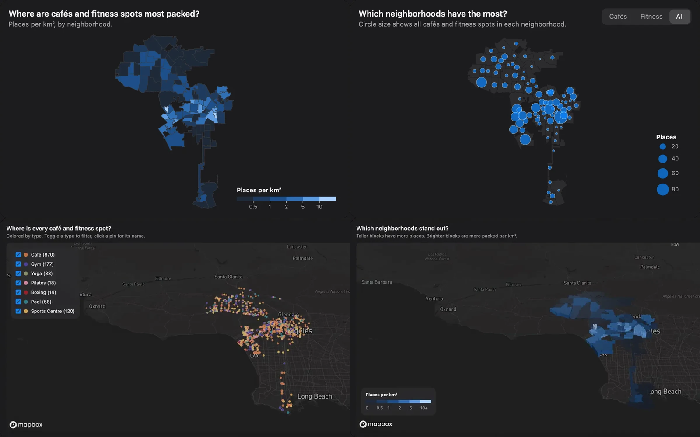

# LA Coffee & Fitness Maps

Where are the cafés and the gyms, and how far is a coffee from a workout?

People love grabbing coffee before or after the gym. This maps every café and fitness spot in Los Angeles across four pages: density by neighborhood, proportional symbols, filterable pins, 3D neighborhood towers, and the distance from each workout to the nearest coffee.

**[Live demo](https://lemynsu.github.io/la-coffee-fitness/)**



## The pages

- **Overview**: a D3 choropleth and a Vega-Lite symbol map of places per km² by neighborhood.
- **All Places**: every café and fitness spot as a filterable pin, colored by type.
- **3D View**: deck.gl towers, taller where there are more places.
- **Coffee Treks**: arcs from each workout spot to its nearest café, for trips of 500 m or more.

## Run it

```bash
npm install
npm run dev
```

`npm run build` writes the static site to `docs/`, which is what the live demo serves.

## Data

Places from OpenStreetMap (Overpass API) and neighborhood boundaries, reduced to small files in `public/data/` with `npm run fetch-data`. Map tiles are CARTO Dark Matter through MapLibre GL, so there is no API key to set up.

Built with Vue 3, D3, Vega-Lite, deck.gl and MapLibre by [Evelyn Su](https://evlynsu.com).
